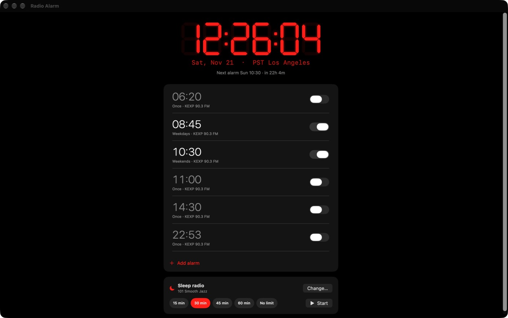

# Radio Alarm

A free, open-source alarm clock for macOS that wakes you up with **live radio**.



## Features

- **Wake up to any radio station.** Comes with a few presets (KEXP, WNYC, KQED) and can search thousands of stations from the [radio-browser.info](https://www.radio-browser.info) directory.
- **Gentle wake-up.** The volume rises step by step, and your normal volume is put back afterwards.
- **Always rings out loud.** The alarm plays through the Mac's speakers, even if AirPods or headphones are connected.
- **Backup sound.** If you're offline or the station is down, a built-in sound plays until the radio connects.
- **Repeating or one-time alarms**, with a snooze length for each alarm and **Skip next** for a day off.
- **Swipe actions** on a trackpad: swipe right to pin an alarm to the top, swipe left to delete it or skip its next ring.
- **Sleep radio.** Fall asleep to a station for 15–60 minutes, then it fades out.
- **Hard to miss by accident:**
  - Closing the window keeps the app running in the menu bar.
  - Quitting asks first.
  - If the app was quit anyway (or crashed), it reopens itself 5 minutes before each alarm.
  - It stops by itself after 15 minutes if nobody presses Stop.
- **Follows your time zone** when you travel.
- Red seven-segment clock, always in dark mode.

## Requirements

- macOS 14 (Sonoma) or later
- Apple Silicon Mac (M1 or newer)

## Install

1. Download `RadioAlarm.zip` from the [latest release](https://github.com/finishtheproject/mac-radio-alarm/releases/latest).
2. Unzip it and drag **RadioAlarm.app** into your **Applications** folder. (Opening at login and reopening before alarms only work from Applications.)
3. Open it. macOS will block it the first time, because the app isn't notarized by Apple (that costs $99/year).
4. Go to **System Settings → Privacy & Security**, scroll down, and click **Open Anyway** next to the Radio Alarm message. Then open the app again.

Or, in Terminal, after moving it to Applications:

```bash
xattr -dr com.apple.quarantine /Applications/RadioAlarm.app
```

## Important: keep your Mac awake

Radio Alarm can only ring while your Mac is **awake and you're logged in**. The app keeps the screen on while it's open, but **closing the lid puts the Mac to sleep and the alarm will not ring**. Leave the lid open (or use an external display) overnight.

## Build from source

Requires the Xcode command line tools (`xcode-select --install`).

```bash
git clone https://github.com/finishtheproject/mac-radio-alarm.git
cd mac-radio-alarm
./build.sh
```

`build.sh` compiles the app and installs it to `/Applications/RadioAlarm.app`. It quits a running copy first, so open the app again afterwards.

The whole app is one Swift file, [`RadioAlarm.swift`](RadioAlarm.swift).

## License

[MIT](LICENSE). Free to use, change and share.
